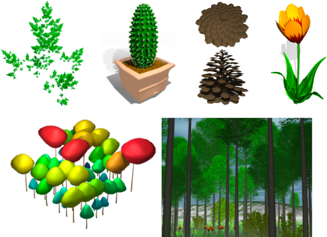

# PlantGL

_________________

[](https://plantgl.readthedocs.io/)
[](https://github.com/openalea/plantgl/actions/workflows/openalea_ci.yml?query=branch%3Amaster)
[](https://www.cecill.info/licences/Licence_CeCILL-C_V1-en.html)
[](https://anaconda.org/openalea3/openalea.plantgl)
[](https://anaconda.org/openalea3/openalea.plantgl)
[](https://anaconda.org/openalea3/openalea.plantgl)



**PlantGL** is an open-source graphic toolkit for the creation, simulation and analysis of 3D virtual plants.

Several methods are provided to create plant architectures from field measurements or from procedural algorithms. Because they reveal particularly useful in plant design and simulation, special attention has been paid to the definition and use of branching system envelops.

PlantGL is designed to be:

- **Open source**: PlantGL is an open source software and can thus be freely used and extended. Providing a standard graphic toolkit to the plant modeling community, it benefits in return of the tests and improvements of users.
- **Portable**: PlantGL is available on major operating systems (GNU Linux, Microsoft Windows). It is also compatible with various plant modeling systems (L-studio, AMAP, etc.) and graphic toolkits (Pov-Ray, Vrml, etc.).
- **Simple**: The intended audience is researchers of the plant modeling community with no knowledge in computer graphics. Researchers could create images to illustrate and explore their results.
- **Modular**: PlantGL is composed of several independent modules like a geometric library, GUI components and Python wrappers. They can be used alone or combined in a specific application.
- **Hybrid System**: Core computational components of PlantGL are implemented in the C++ compiled language for performance. In addition for flexibility of use, these components are also exported in the Python interpreted language.

## Installation

`PlantGL` distribution is based on the `conda` software environment management system.
To install conda, you may refer to its installation page: https://docs.conda.io/projects/conda/en/latest/user-guide/install/

To install PlantGL, you need to create an environment (named for instance pgl):

```bash
mamba create -n pgl ipython openalea.plantgl -c openalea3 -c conda-forge
mamba activate pgl
```

The package `openalea.plantgl` is retrieved from the `openalea3` channel (development) and its dependencies will be taken from `conda-forge` channel.

Then, you need to activate the pgl environment and add optional dependencies:

```bash
conda activate pgl
conda install -c conda-forge ipython matplotlib-base pandas tzfpy geopy trimesh
```

You can then run the PlantGL viewer:

```bash
pglviewer
```

Or use the PlantGL modules in Python:

```bash
ipython
```

```python
>>> %gui qt
>>> from openalea.plantgl.all import *
>>> Viewer.display(Sphere())
```

## Installation for developers

PlantGL is compiled in a conda environment (mamba 2 is required to combine several
environment files). The dependencies are split into several files:

| File | Content |
|---|---|
| `environment-linux.yaml`, `environment-macos.yaml`, `environment-win.yaml` | compilers, build tools and test tools of your system |
| `conda/host_deps.yml` | libraries PlantGL is compiled against |
| `conda/run_deps.yml` | runtime dependencies |
| `conda/optional_deps.yml` | optional dependencies (mostly for light tools) |
| `doc/doc_deps.yml` | documentation tools (only to build the documentation) |

System requirements:

- **Windows**: Visual Studio 2022 with the C++ tools.
- **macOS**: the Xcode Command Line Tools (`xcode-select --install`).

### 1. Create the environment

From the root of the repository, create a new environment. Replace
`environment-linux.yaml` by `environment-macos.yaml` or `environment-win.yaml` depending on
your system:

```bash
mamba create -n plantgl-devel -f environment-linux.yaml -f conda/host_deps.yml -f conda/run_deps.yml -f conda/optional_deps.yml -f doc/doc_deps.yml
mamba activate plantgl-devel
```

Or add the dependencies to an existing environment:

```bash
mamba install -n myenv -f environment-linux.yaml -f conda/host_deps.yml -f conda/run_deps.yml -f conda/optional_deps.yml -f doc/doc_deps.yml
mamba activate myenv
```

`-f doc/doc_deps.yml` can be left out if you do not build the documentation.

### 2. Compile and install PlantGL

In the activated environment, from the root of the repository:

```bash
pip install -e . --no-deps --no-build-isolation -v
```

- `--no-deps --no-build-isolation`: pip uses the conda environment as is and installs no
  dependency.
- CMake runs through scikit-build-core. The build directory `build/` is reused, so the next
  builds only recompile what changed.
- `-e` (editable mode): changes to the Python files of `src/openalea/plantgl` are used
  directly. After a change in the C++ code (`src/cpp`, `src/wrapper`), run the same `pip
  install` command again.

### 3. Run the tests

```bash
cd test
pytest -v
```

The `tofix`, `ui` and `oatest` directories are skipped (see `test/pytest.ini`).

### 4. Build the documentation

The environment must include `doc/doc_deps.yml` and PlantGL must be installed (step 2): the
documentation reads the package version and the docstrings from the installed package.
From the root of the repository:

```bash
cd doc
make html
```

Then open `doc/_build/html/index.html` in a browser. On Windows, the same command runs
`doc/make.bat` in cmd; in PowerShell, type `.\make html`. Other targets:

- `make rtdhtml`: same settings as Read the Docs (warnings become errors).
- `make clean`: remove the built documentation.

## Documentation

Documentation is available at [https://plantgl.readthedocs.io/en/latest](https://plantgl.readthedocs.io/en/latest)

### Help and Support

Please open an **Issue** if you need support or that you run into any error (Installation, Runtime, etc.).
We'll try to resolve it as soon as possible.

## Authors

PlantGL was developed by Frédéric Boudon, Christophe Pradal, Christophe Nouguier with contributions of Christophe Godin, Nicolas Dones, Boris Adam, Pierre Barbier de Reuille, etc.

## Contributors

Thanks to all that contribute making this package what it is !

<a href="https://github.com/openalea/plantgl/graphs/contributors">
  
</a>


## Citation

If you find our work useful in your research, please consider citing:

> Pradal C., Boudon F., Nouguier C., Chopard J., Godin C.. 2009. PlantGL: A python-based geometric library for 3D plant modelling at different scales. Graphical Models, 71: p. 1-21.

